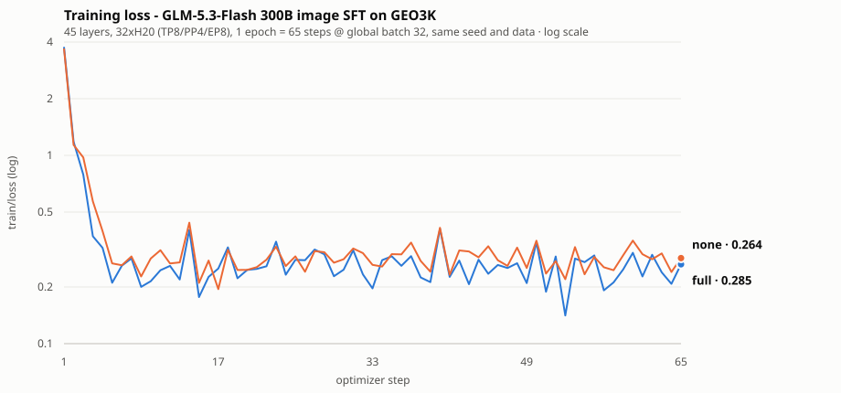

# GLM-5.3-Flash Image SFT: Experiment Record

What has and has not been measured for `--vision-trainable`, with the commands to
reproduce each number. The feature itself is documented in
[glm5-3-flash.md](glm5-3-flash.md#6-bf16-image-sft); this page is the evidence
behind it.

**Summary: the training path works at full scale; its effect on image-task quality
is not measured.** Nothing here says that training the visual tower helps.

## 1. Full-model training run

45-layer GLM-5.3-Flash on 32xH20 (TP8/PP4/EP8/SP, CP1), GEO3K's 2101 image-text
train rows, one epoch = 65 steps at a global batch of 32. Both arms used the same
seed, data order and hyper-parameters, and differ only in `--vision-trainable`.



| | `none` | `full` |
|---|---|---|
| trainable visual params | 0 | 563,627,008 |
| step 1 | 3.768 | 3.696 |
| step 65 | **0.264** | **0.285** |
| minimum | 0.141 | 0.195 |
| checkpoint saved | yes | yes |

Per-step values: [`assets/loss_curves.csv`](assets/loss_curves.csv).

Both arms converge without diverging or producing NaNs, every rank reports the
same gradient norm, and the checkpoints load back. That is the claim this run
supports.

**It does not rank the two arms.** The scopes differ by 563,627,008 trainable
parameters, so equal-step loss is not a like-for-like comparison, and the GEO3K
targets are a bare `Answer: \boxed{...}` line (median 18 characters) that is easy
to fit either way.

### Reproducing

```bash
# 32 GPUs, external Ray. One command per arm; they are independent.
MILES_SCRIPT_EXTERNAL_RAY=1 python scripts/run_glm5_3_flash_vision_sft.py \
  --model-name GLM-5.3-Flash --num-nodes 4 --num-gpus-per-node 8 \
  --hf-checkpoint /root/models/GLM-5.3-Flash-BF16 \
  --ref-load /root/models/glm5.3-flash_torch_dist \
  --prompt-data /root/datasets/geo3k/train.jsonl \
  --output-dir /root/runs/geo3k_none \
  --vision-trainable none \
  --num-rollout 65 --rollout-batch-size 32 --global-batch-size 32 \
  --save-interval 65 --max-tokens-per-gpu 2048 --lr 1e-5
```

Swap `--vision-trainable full` and the output directory for the second arm; the
launcher adds `--glm5-vision-recompute` for that scope on its own.

Only the visual shard of the HF checkpoint is read (all 347 `model.visual.*`
tensors live in `model-00062-of-00062.safetensors`), so `--hf-checkpoint` does not
need the full 306 GB export. The language weights come from `--ref-load`.

### The data these runs used

`train.jsonl` is GEO3K in the format
[the feature page specifies](glm5-3-flash.md#dataset): one row per sample, with a
`messages` conversation and an `images` list of readable paths.

```json
{
  "messages": [
    {"role": "user", "content": "Solve the following math problem step by step. The last line of your response should be of the form Answer: \\boxed{$Answer} where $Answer is the answer to the problem.\n\n<image>Find x."},
    {"role": "assistant", "content": "Answer: \\boxed{48}"}
  ],
  "images": ["/root/datasets/geo3k/images_train/54b363a493f4b5a9.png"]
}
```

Built from [`chenhegu/geo3k_imgurl`](https://huggingface.co/datasets/chenhegu/geo3k_imgurl)
(2101 train / 601 test rows, one image each). Two things about that dataset are
easy to get wrong: the decoded images are in `preprocessed_images`, not `images`
(which holds base64 data URIs), and `problem` already carries its own `<image>`
placeholder and `\boxed{}` instruction, so neither needs to be added. The
assistant target is `f"Answer: \\boxed{{{row['answer']}}}"`.

Any dataset in this shape reproduces the run; the numbers above are specific to
this one.

## 2. Zero-shot baseline, for context

The same 45-layer model on GEO3K's 601 test rows, untrained, greedy, 2048 new
tokens:

| | |
|---|---|
| exact-match accuracy | 6.82% (41/601) |
| produced a `\boxed{}` | 34.9% (210/601) |
| accuracy among those | **19.52%** (41/210) |
| ran out of tokens | **65.1%** |

The model does real geometry - it writes a derivation and a `\boxed{}` answer -
but its reasoning is long (median 6463 characters), so two thirds of the rows are
cut off before the answer. At this token budget the headline number mostly
measures whether a response finishes, not whether it is correct.

## 3. What is not measured, and why GEO3K cannot measure it

There is **no evidence about whether training the visual tower improves image-task
quality**, and this dataset cannot provide it.

GEO3K's prompt asks the model to "Solve the following math problem step by step",
but its SFT target contains no steps - just `Answer: \boxed{48}`, a median of 18
characters against the 6463 the model generates unprompted, a factor of 359. Training
on it teaches the model to skip the reasoning the prompt asks for.

That matters for this comparison specifically: if the task collapses to emitting a
short string, the image contributes little and the arms converge regardless of
whether the tower trains. Any "no difference" result would be a property of the
data, not a finding about the visual tower.

Measuring the effect needs targets that contain the derivation - distilled from
correct model-generated solutions, or a geometry set that ships rationales.

## 4. Smaller-scale checks

The 4-layer slice (`--model-name GLM-5.3-Flash-4layer`) is a startup fixture: it
exercises parallelism, gradients and checkpointing cheaply, and all three scopes
run 195 steps on it.

**Do not use it for anything that depends on model behaviour.** It cannot generate
text - the untrained slice emits `Unload unload unload...` and a trained one emits
`}}}}`, so task accuracy on it is identically zero and cannot separate any two
configurations.
