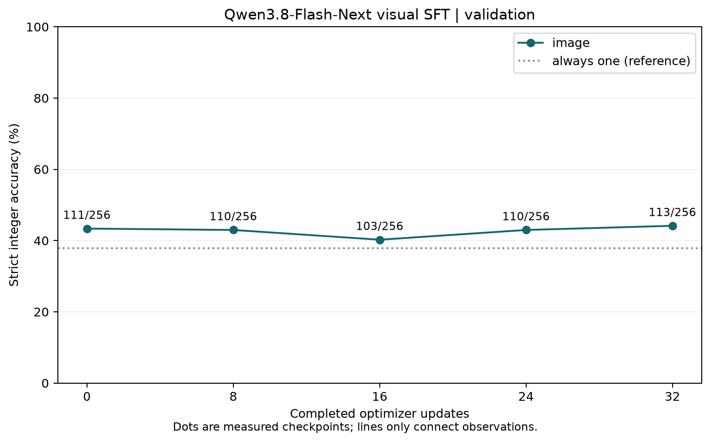
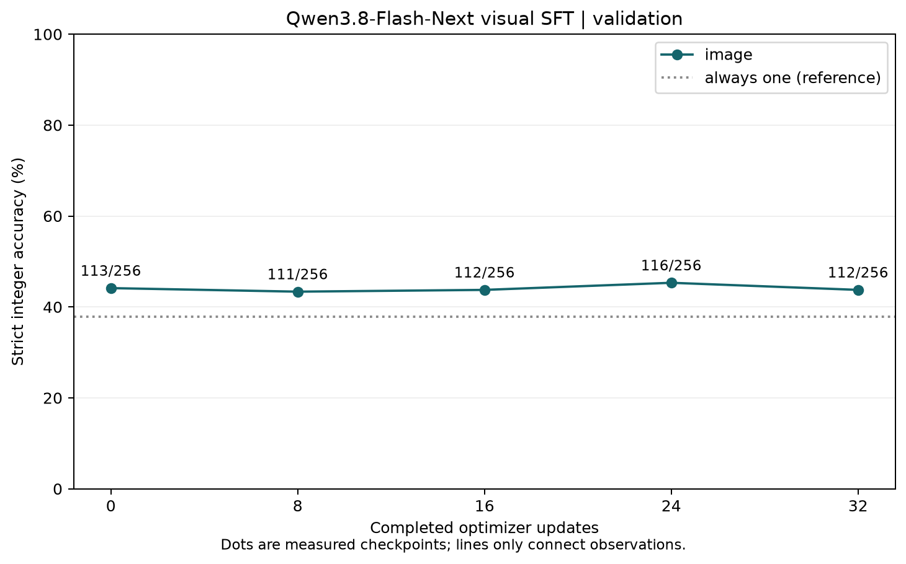

The complete Qwen3.8-Flash-Next RL implementation is open at the Miles pull request:
[`radixark/miles#2777`](https://github.com/radixark/miles/pull/2777). It lands as a set of
three: that branch, the SGLang
[`sglang-miles-qwen38next`](https://github.com/sgl-project/sglang/tree/sglang-miles-qwen38next)
branch, and [`radixark/Megatron-LM#89`](https://github.com/radixark/Megatron-LM/pull/89).
The image in [section 3](#3-environment-setup) pins all three.

For native image supervision rather than generated RL rollouts, see
[Image SFT](#7-image-sft). That integration has separate qualification evidence;
the RL recipe and its sliced CI test do not establish visual training quality.

## 1. Model Introduction

[Qwen3.8-Flash-Next](https://docs.sglang.io/cookbook/autoregressive/Qwen/Qwen3.8-Flash-Next)
is Qwen's **176 B-parameter (6 B active) GDN + QSA hybrid Mixture-of-Experts preview of the
Qwen4 architecture**. Despite the shared prefix it is not a variant of the dense
[Qwen3.8-27B](/models/qwen/qwen3-8) — it is the next step of the *Next* line that
[Qwen3-Next](/models/qwen/qwen3-next) started, and structurally it has far more in common
with that model than with anything else carrying the Qwen3.8 name.

The block spec is still a uniform GPT decoder, but three components sit outside what a
stock Megatron layer provides, and each one is why a piece of this recipe exists:

**Hyper-connections replace the block layernorms.** The checkpoint ships none: each
hyper-connection's own `hc_norm` *is* the pre-block norm, so the spec drops every block
layernorm and a leftover TE fused norm corrupts the forward pass silently rather than
loudly. Miles fills Megatron's HC `ModuleSpec` slots, but Qwen's output contraction is not
DeepSeek-V4's `learned_output_contract` — it is the same low-rank gated mean as the
per-layer hyper-connections, with the RMS taken per stream rather than over the whole
`n*C` vector. That needed a new Megatron spec slot, `hc_head_contraction`, which is what
Megatron#89 adds; the DeepSeek-V4 default path and its parameter names are untouched.

**QSA (Qwen Sparse Attention) on the full-attention layers.** Twelve of the 48 layers are
full attention. Each projects its own indexer queries and compressed keys, scores them, and
keeps `indexer_budget` key tokens per query; attention then reads only those. Miles
reimplements the indexer and a forward *and backward* Triton sparse-attention kernel rather
than importing SGLang's inference path, with the selection rows built torch-side so the
kernel needs no causal or segment logic of its own.

**A frozen, host-resident PLE table.** The per-layer-embedding n-gram table is ~102 GB. It
lives in host memory, TP-row-sharded, and is deliberately *not* a checkpointed parameter;
token ids reach it over an explicit side channel that raises rather than defaulting when
nothing was published. It is also on the weight-update check's skip list — see
[section 5.5](#55-notable-quirks).

**Key highlights:**

- **48 layers, hybrid**: 36 GDN linear-attention layers + 12 QSA full-attention layers, from
  the released config's `layer_types` (equivalently, every 4th layer is full attention).
- **512-expert MoE at top-10**, `moe-ffn-hidden-size 640`, plus a gated shared expert.
- **Hyper-connections** at every block, with a model-supplied output contraction.
- **PLE** n-gram embeddings, frozen and host-resident.
- **Attention output gate**, `--qk-layernorm`, `--apply-layernorm-1p`.
- **Shape**: hidden 2560, 24 attention heads, 2 query groups, `kv-channels 256`,
  vocab 248320, `--rotary-base 10000000` at `--rotary-percent 0.25`.

Two things the model args deliberately leave out: MTP (`--mtp-num-layers` is omitted, the
MTP tensors are not mapped yet) and the hyper-connection / PLE / QSA fields themselves,
which have no Megatron CLI flags and are derived from the checkpoint by the spec in
`miles_plugins/models/qwen3_8_next/qwen3_8_next.py`.

On the parameter count: Qwen's published headline is 176 B total / 6 B active, while the
docstring in `scripts/models/qwen3.8-flash-next.py` counts 180 B / ~7.4 B from the released
`config.json` shapes. Nothing in the recipe depends on which figure you quote.

## 2. Supported Variants

| Variant | `--model-name` | Layers | Purpose | GPUs |
|---|---|---|---|---|
| Full | `Qwen3.8-Flash-Next` | 48 | the real model | 32 (8 × 4) |
| Smoke slice | `Qwen3.8-Flash-Next-4layer` | 4 | CI and single-node bring-up | 1 × 4 or 1 × 8 |

`--model-name` selects between them and sets the matching `megatron_model_type`
(`qwen3.8-flash-next` / `qwen3.8-flash-next-4layer`), which in turn resolves the model args
and the `torch_dist` path. The launcher asserts the node shape, so a mismatched
`--num-nodes` / `--num-gpus-per-node` fails immediately rather than mid-run.

## 3. Environment Setup

Use the `docker.io/radixark/miles:qwen38next` image. It is the rolling
[`radixark/miles:dev`](/developer/ci/02-docker-build) image with the three moving parts checked out at
the versions this recipe was built against, and nothing else changed — every prebuilt wheel,
TransformerEngine patch and version pin comes from `dev`. It is multi-arch, so the same tag
serves GB300 (aarch64) and x86 nodes.

| Component | Pinned at |
|---|---|
| miles | [`#2777`](https://github.com/radixark/miles/pull/2777) `afd78afd` |
| SGLang | [`sglang-miles-qwen38next`](https://github.com/sgl-project/sglang/tree/sglang-miles-qwen38next) `599d7403` |
| Megatron-LM | [`#89`](https://github.com/radixark/Megatron-LM/pull/89) `e8f57451` |

### 3.1 Download model + dataset

```bash
hf download Qwen/Qwen3.8-Flash-Next --local-dir /root/models/Qwen3.8-Flash-Next
hf download --repo-type dataset zhuzilin/dapo-math-17k --local-dir /root/datasets/dapo-math-17k
```

For the smoke slice, download
[`CharyZeng/Qwen3.8-Flash-Next-4layer`](https://huggingface.co/CharyZeng/Qwen3.8-Flash-Next-4layer)
into `/root/models/Qwen3.8-Flash-Next-4layer` instead — the launcher resolves
`--hf-checkpoint` as `<--model-dir>/<--model-name>`, which is the same path CI uses.

### 3.2 HF → Megatron `torch_dist` conversion

Unlike the launcher-prepared recipes, this one takes the converted reference checkpoint as
given: `--ref-load` resolves to `<--ckpt-dir>/<megatron_model_type>_torch_dist`, so the
conversion has to have run first. The output re-shards at load, so the conversion layout
does not have to match the training one:

```bash
cd /root/miles
MODEL_ARGS_LINE="$(python3 miles/utils/external_utils/model_args_utils.py qwen3.8-flash-next)" || exit 1
read -ra MODEL_ARGS <<< "${MODEL_ARGS_LINE}"
CONVERT_KEEP_PP1=1 PYTHONPATH=/root/Megatron-LM torchrun --nproc-per-node 8 \
   tools/convert_hf_to_torch_dist.py \
   "${MODEL_ARGS[@]}" \
   --hf-checkpoint /root/models/Qwen3.8-Flash-Next \
   --save          /root/ckpt/qwen3.8-flash-next_torch_dist \
   --tensor-model-parallel-size 2 \
   --pipeline-model-parallel-size 1
```

Swap `qwen3.8-flash-next` for `qwen3.8-flash-next-4layer` throughout to convert the smoke
slice.

## 4. Launch

The launcher assumes an **already-running ray cluster**: bring one up across the nodes,
`export MILES_SCRIPT_EXTERNAL_RAY=1`, then run on the head node.

Full model, 8 nodes × 4 GPUs:

```bash
cd /root/miles
python scripts/run_qwen3_8_next.py train \
  --model-name Qwen3.8-Flash-Next \
  --num-nodes 8 --num-gpus-per-node 4 \
  --num-rollout 5 --rollout-max-response-len 4096
```

Single-node smoke slice:

```bash
python scripts/run_qwen3_8_next.py train \
  --model-name Qwen3.8-Flash-Next-4layer \
  --num-nodes 1 --num-gpus-per-node 8
```

Paths come from `--model-dir` (default `/root/models`), `--data-dir` (default
`/root/datasets`), `--ckpt-dir` (default `/root/ckpt`) and `--megatron-path` (default
`/root/Megatron-LM`). Saving is off by default (`skip_saving`); turning it on writes
checkpoints under `<--save-dir>/<--run-id>/checkpoints` every 10 rollouts, without optimizer
or RNG state.

## 5. Recipe Configuration

### 5.1 Parallelism

| Shape | TP | PP | CP | EP | ETP | Rollout engine |
|---|---|---|---|---|---|---|
| 8 × 4 (full) | 2 | 8 | 1 | 4 | 1 | 8 GPUs, SGLang TP 8 / EP 8 |
| 1 × 4 (4layer) | 2 | 2 | 1 | 2 | 1 | 4 GPUs, SGLang TP 4 / EP 4 |
| 1 × 8 (4layer) | 2 | 2 | 1 | 4 | 1 | 4 GPUs, SGLang TP 4 / EP 4 |

`--sequence-parallel` is on in every shape. Activation checkpointing is full and uniform at
one layer, with `--micro-batch-size 1` and `--max-tokens-per-gpu 8192`.

### 5.2 Algorithm

GRPO, DAPO-Math-17k, thinking mode on:

```bash
--advantage-estimator grpo
--kl-loss-coef 0.00
--kl-loss-type low_var_kl
--entropy-coef 0.00
--eps-clip 0.2
--eps-clip-high 0.28
--rollout-batch-size 4
--n-samples-per-prompt 8
--rollout-temperature 0.8
--apply-chat-template-kwargs '{"thinking_mode":"thinking"}'
```

Adam at `--lr 1e-6`, constant schedule, `--weight-decay 0.1`,
`--adam-beta1 0.9 --adam-beta2 0.98`.

### 5.3 Rollout & SGLang

Rollout is **colocated** — trainer and engines share the GPUs — and the trainer offloads to
**disk** rather than host RAM during rollout (`--offload-train-target disk`,
`--offload-train-disk-dir /tmp/train_offload`). Worth keeping in view when sizing hosts: the
PLE table is already holding ~102 GB of host memory for the full model. The 4-layer CI slice
overrides the target back to `--offload-train-target cpu`.

```bash
--sglang-linear-attn-prefill-backend flashinfer   # GDN prefill
--sglang-moe-runner-backend triton
--sglang-chunked-prefill-size 8192
--sglang-disable-radix-cache
--sglang-mem-fraction-static 0.7
--linear-attention-backend flashqla               # trainer-side GDN
--qkv-format thd
```

The recipe loosens router
health checking (`--router-health-failure-threshold 40`,
`--router-health-check-interval-secs 15`, `--router-health-success-threshold 1`) and raises
`--rollout-health-check-interval` / `--rollout-health-check-timeout` to 300 s.

### 5.4 What CI watches

`tests/e2e/megatron/model_scripts/test_qwen3_8_next_4layer_ci.py` runs the 4-layer slice on
8 × H200 in `stage-c-8-gpu-h200` with rollout-routing replay on, and gates these metrics:

- `train/grad_norm`
- `train/ppo_kl`
- `train/train_rollout_logprob_abs_diff`
- `train/train_rollout_kl`
- `rollout/raw_reward`

`train/train_rollout_logprob_abs_diff` is the one to read first on a fresh bring-up: it is
the direct measure of whether the SGLang and Megatron forward passes agree, and on this
architecture that covers the GDN, QSA and hyper-connection paths at once. See
[True On-Policy](/examples/infra-features/true-on-policy) for what the metric does and does
not tell you.

### 5.5 Notable quirks

- **Weight-update checking skips two prefixes.** `--check-weight-update-equal` runs with
  `--check-weight-update-skip-list visual. ple_embedding.` — the PLE table is frozen and
  never shipped, so comparing it would fail on a parameter that is working as intended.
- **Every block layernorm is dropped.** The checkpoint has none; each hyper-connection's
  `hc_norm` is the pre-block norm. A leftover TE fused norm corrupts silently.
- **`--moe-aux-loss-coeff 0`.** Routing is not auxiliary-loss balanced here.
- **Triton and Inductor caches are pinned to `/tmp`** (`TRITON_CACHE_DIR`,
  `TORCHINDUCTOR_CACHE_DIR`) with `TORCHINDUCTOR_COMPILE_THREADS=1`.
- **`SGLANG_DISABLE_MULTIMEM_AG=1`** and `SGLANG_SKIP_CHECKPOINT_LOAD_CHECK=1` are set for
  the engines.
- The model lives in `miles_plugins/models/qwen3_8_next/`, and weight conversion in
  `miles/backends/megatron_utils/megatron_to_hf/qwen3_8_next.py`.

## 6. Pairs Well With

- [Qwen3-Next](/models/qwen/qwen3-next) — the previous generation of the same line
- [Qwen3.8](/models/qwen/qwen3-8) — the dense 27 B that shares the name and not the architecture
- [Disk Offload](/advanced/disk-offload)
- [True On-Policy](/examples/infra-features/true-on-policy)

## 7. Image SFT

### Completed Five-Epoch Vision-Only Result

The complete native visual tower and merger were trained with the language model
frozen. The fixed final checkpoint at **160 cumulative updates** improves both
the full 1024-scene training set and the fixed 256-scene validation set:

| Fixed scene set | Original base | Update 160 | Change | Wrong → right | Right → wrong |
| --- | ---: | ---: | ---: | ---: | ---: |
| Training, 1024 scenes | 448/1024 (43.75%) | 511/1024 (49.90%) | **+6.15 pp, net +63** | 221 | 158 |
| Validation, 256 scenes | 113/256 (44.14%) | 125/256 (48.83%) | **+4.69 pp, net +12** | 59 | 47 |


These bars show two measured endpoints. Intermediate checkpoints of this
continuation were not evaluated. Both endpoints use genuine images, identical
ordered scene IDs, questions, labels, pixels, expanded input tokens and native
assistant prefills. Thinking stays enabled at `low`, with greedy decoding,
16384 output tokens, context 32768, TP8/EP8, batch size 256 and CUDA graphs.
The integer-only instruction and `integer_last_final_line_v2` scorer are the same
for both endpoints. There is no integer-constrained decoder or closed-thinking
prefill in this evaluation.

The improvement persists among scenes where both answers have valid formats:
**net +58 training scenes and net +12 validation scenes**. Validity transitions
contribute the remaining net +5 training scenes and net zero validation scenes.
Invalid answers fall from 19 to 6 on training and change from 1 to 2 on validation.


The [canonical result and exact protocol](../../assets/images/qwen3-8-flash-next-vision-sft/u160-results.json),
[1024 training pairs](../../assets/images/qwen3-8-flash-next-vision-sft/u160-training1024-pairs.jsonl)
and [256 validation pairs](../../assets/images/qwen3-8-flash-next-vision-sft/u160-validation256-pairs.jsonl)
retain the exact per-scene integer comparison. All aggregates were recomputed
from retained raw predictions before publishing. The training baseline combines
256 previously qualified identical requests with 768 newly completed requests;
the resulting denominator is the same 1024 scenes as the final checkpoint.

The continuation uses **four eight-GPU B300 nodes, TP8/DP4/PP1/EP8**, global batch
32, micro-batch 1, constant LR `1e-6`, Adam betas `(0.9, 0.98)`, zero weight decay
and gradient clipping at 1. Updates 1–64 were trained on one eight-GPU node;
updates 65–160 continue from its audited update-64 visual state. Adam state was
**reset at update 64**. This is five nominal passes through 1024 training scenes,
with no claim of uninterrupted optimizer or data-cursor resume.


The [loss data](../../assets/images/qwen3-8-flash-next-vision-sft/u160-training-loss.json)
contains every actual continuation update, without smoothing or filling missing
points. Mean losses for epochs 3/4/5 are 0.293/0.279/0.257. Each point uses a
different training batch; the average includes the fixed answer-boundary tokens.

The [rank and source audit](../../assets/images/qwen3-8-flash-next-vision-sft/u160-training-audit.json)
covers **333 visual tensors / 448,931,056 parameters**, all 32 final rank audits,
unchanged complete language hashes, identical visual replica hashes and 32
successful native model-only reload checks. All 25 inventoried model, bridge,
launcher and evaluator source files match commit
[`2aa7a69d`](https://github.com/leviking98z-rgb/miles/commit/2aa7a69d6855bb4293b5273a930e25cdafd6f7fa). The final
complete visual parameter hash is
`619d90d4c362f100e86b65bc94ac41fc46c486ea46ae80a7cc9be0359c283d2f`.
The native checkpoint iteration is 95, corresponding to the 96th continuation
update and cumulative update 160. Model weights and raw prediction/audit files
remain on the project disk; this page publishes their hashes and paired answers.

The public launcher expresses the measured continuation as follows. The HF
checkpoint supplied here contains the audited update-64 visual weights and the
unchanged original language weights:

```bash
MILES_SCRIPT_EXTERNAL_RAY=1 python scripts/run_qwen3_8_next_vision_sft.py \
  --hf-checkpoint /root/models/Qwen3.8-Flash-Next-vision-u64 \
  --prompt-data /root/datasets/geometry/sft_exact.jsonl \
  --output-dir /root/runs/qwen38-vision-continuation \
  --num-nodes 4 --num-gpus-per-node 8 --tp-size 8 --pp-size 1 --ep-size 8 \
  --freeze-language --vision-trainable full --enable-thinking \
  --reasoning-effort low --final-answer-format integer-only \
  --num-rollout 96 --save-interval 96 --visual-snapshot-interval 32 \
  --lr 1e-6 --weight-decay 0 \
  --extra-args "--make-vocab-size-divisible-by 64"
```

The explicit vocabulary alignment preserves the native 248320-row embedding
when using TP8. An allocated, already-joined Ray cluster and the documented native
dependencies remain prerequisites. Rebuild all three figures with
`python -m tools.plot_qwen38_vision160_results`.

This meets the task's engineering criterion of **real visual updates plus observed
validation-score improvement**. The training set remains far from perfectly fit.
The validation set was also used in earlier debugging; this is one run, without
new matched image-removal/swapping controls or a multiple-seed estimate. The
earlier experiments below preserve their own protocols and are separate runs.

### Five-Epoch Joint Language And Visual SFT

A separate run starts from the **original base model**, enables language and
visual updates, and trains 160 updates on the same 1024 image questions. Only
the saved final step 160 was evaluated. The
[training protocol](../../assets/images/qwen3-8-flash-next-joint-sft/joint160-training-protocol.json)
was recorded before training. The retained original-base and visual-only
predictions use identical ordered scene IDs, questions, labels, image pixels,
expanded input tokens, assistant prefills and evaluation settings.

| Fixed scene set | Original base | Visual-only step 160 | Joint saved step 160 |
| --- | ---: | ---: | ---: |
| Training, 1024 scenes | 448/1024 (43.75%) | 511/1024 (49.90%) | **778/1024 (75.98%)** |
| Validation, 256 scenes | 113/256 (44.14%) | 125/256 (48.83%) | **189/256 (73.83%)** |


Against the original baseline, joint SFT gains **32.23 percentage points** on
training and **29.69 points** on validation. Validation has 88 wrong-to-right
and 12 right-to-wrong changes. Of its net 76 additional correct answers, 75 are
from examples with valid formats at both endpoints and one from a validity
transition. All 1280 joint answers have valid integer formats. The same held-out
questions improve by net 64 answers / 25.00 points over visual-only SFT.

The [result and protocol evidence](../../assets/images/qwen3-8-flash-next-joint-sft/joint160-results.json),
[1024 training pairs](../../assets/images/qwen3-8-flash-next-joint-sft/joint160-training1024-pairs.jsonl)
and [256 validation pairs](../../assets/images/qwen3-8-flash-next-joint-sft/joint160-validation256-pairs.jsonl)
retain the measured counts and changes. Exact integer scoring remains
`integer_last_final_line_v2`. Thinking is enabled at `low`; native SGLang uses
greedy decoding, 16384 output tokens, context 32768, TP8/EP8, batch size 256
and CUDA graphs, without constrained decoding or a closed-thinking prefill.

This run uses four eight-GPU nodes, **TP8/DP4/PP1/EP8/ETP1**, global batch 32,
micro-batch 1, LR `1e-6` constant, Adam `(0.9, 0.98)`, weight decay zero,
gradient clipping at 1, BF16 model weights and full FP32 CPU-offloaded optimizer
state. Its 160 updates use fresh Adam continuously, unlike the visual-only run's
reset at update 64. Language and visual hashes changed in all 32 final rank audits.
PLE remains immutable; the discrete QSA indexer and unused MTP are not trained.
Assistant targets contain native answer-boundary tokens and the integer answer;
there are no supervised reasoning traces. Joint parameter training therefore
does not establish a reasoning-trace training result.


Epoch mean losses are **0.21623, 0.09650, 0.06366, 0.04577, 0.04758**; the
last logged loss is 0.05182. These are 160 actual batch losses, without smoothing.
The [measured CPU/CUDA profile](../../assets/images/qwen3-8-flash-next-joint-sft/joint160-performance-summary.json)
separates CPU regions and GPU intervals; their overlaps must not be added as
disjoint wall-time percentages. A live four-to-eight CPU-thread trial reduced
the observed step median by only 3.18% on different batches. It was
[reverted to four threads](../../assets/images/qwen3-8-flash-next-joint-sft/joint160-thread-tuning-decision.json)
without changing optimizer state. No stable throughput improvement is claimed.

**Saved-model qualification is separate from live-model restoration.** The
160 training updates completed, but the subsequent exact native reload check
failed on nonzero TP ranks; only four TP0 ranks returned successful reload
receipts. The original job's failure and strict checks are retained. Its cause
has not been localized. These scores evaluate an explicitly separate
`--saved-checkpoint-only` full-model export. The
[export validation receipt](../../assets/images/qwen3-8-flash-next-joint-sft/joint160-export-validation.json)
records all 32 final training audits, all 1496 converted tensors passing finite
checks and exact HF readback, and unchanged native shard inventory. The receipt
explicitly sets `live_model_roundtrip_qualified=false`. It does not qualify
optimizer resume or exact restoration of the original live model. Do not use a
visual-only snapshot overlay to export a jointly updated decoder.

Training source is `d52a4c118fedcdd0af52dab0c110111267000581`; the full-model
exporter/evaluator is `b7c8f0ebe2879d196773984508bb913f63cd120c`, with 64 focused
CPU tests passing on the native training environment. Rebuild both figures with
`python -m tools.plot_qwen38_joint160_results`. Validation was reused during
debugging; this is one run with no independent test set or matched image-removal
controls. The visual-only and joint training schedules also differ, so the
comparison does not isolate language unfreezing as the only cause.

### Scope And Qualification

`scripts/run_qwen3_8_next_vision_sft.py` implements image SFT for the **complete
48-layer** `Qwen/Qwen3.8-Flash-Next` checkpoint. It does not substitute a decoder
slice, a text-only checkpoint, a LoRA adapter, or a different Qwen family.

The provider attaches the entire native Qwen3-VL visual encoder and merger before
Megatron constructs DDP and the optimizer. `--vision-trainable` selects `none`,
`projector`, or `full`; `--freeze-language` trains vision with the decoder frozen.
Without that flag the recipe jointly trains language and vision. The native PLE
lookup table remains an immutable host asset; the discrete QSA indexer is frozen
because its top-k selection does not have task-loss gradients. MTP is not enabled.

The implementation uses the native image processor and whole-conversation chat
template, masks image/user tokens, and supervises the assistant spans after image
token expansion. The released template's thinking option is `enable_thinking`,
not `thinking_mode`. For non-thinking integer supervision, the target is the
integer itself: do not prepend a GLM-style `</think>` suffix.

Image positions use the checkpoint's three-axis, interleaved mRoPE configuration.
The QSA indexer uses physical packed-token rows when indexing these materialized
positions; text-only position resets are not image positions. Image embeddings
replace their exact placeholder rows on each sequence-parallel slice. Visual
replicas participate in tensor-parallel gradient reduction, including slices with
no local image tokens.

Focused CPU contracts pass for image/mRoPE alignment, assistant masks, visual
gradients and updates, recomputation, TP scatter, native weight naming, evaluation
parsing, and launcher safety. The full 48-layer model completed the fixed
32-update vision-only recipe on one eight-GPU B300 node with TP2/PP4/EP2,
batch size 32, learning rate `1e-6`, zero weight decay and `enable_thinking=True`.
Both visual replicas had finite, nonzero gradient probes for all 333 visual
tensors; sampled BF16 values changed in 224 tensors on the final update. Their
complete visual hashes agreed, and snapshots at updates 0/8/16/24/32 passed
exact safetensors readback. All eight complete decoder hashes remained unchanged.
Native Megatron save/reload passed on every rank after deliberately corrupting
every registered parameter, with exact complete-parameter hash restoration.
This qualifies model-only reload, not optimizer/data-cursor resume. The native
checkpoint is iteration 31 because rollout indices start at zero. A preceding
two-update, batch-8 qualification separately passed the same model-only reload
check; its sampled change count was 235 on the second update.

The 32-update run used training source `9e1cb86174cca03279c55db263cc40f8b08fe467`.
Its [fixed protocol](../../assets/images/qwen3-8-flash-next-vision-sft/protocol.json) has SHA256
`5ca5c2a3174c2b09664ef0f605fd9fb7eb223fa83b90a2e97f887db473be27db`;
the final full visual hash is
`4a595c9f5cdb3c856879fe2254d579cfff43413b4246eea475074ac7a736e275`.
The project retains all per-rank runtime/source audits, snapshot receipts and
native reload receipts under `checkpoints/experiments/vision32-v1/audit/`, with
their consolidated qualification in `logs/train-vision32-v1-qualification.json`.
The [recorded training qualification](../../assets/images/qwen3-8-flash-next-vision-sft/training-qualification.json)
includes all eight ranks, actual imported source hashes, and snapshot receipts.
Training used PyTorch `2.11.0+cu130`, Transformers `5.8.1` and Ray `2.56.0`, with
Megatron at `eed6851e5088cff7c10ee195de01f83e21094652`.
The fixed held-out evaluation below is complete. Its small endpoint gain does
not establish a stable improvement across checkpoints or training seeds.

The initial 4096-token development image arms at updates 0/8/16/24 each scored
0/32 under the unchanged strict scorer. Of these 128 predictions, 113 still had
an open thinking block; 15 had closed thinking but an invalid final-answer format.
The [development diagnosis](../../assets/images/qwen3-8-flash-next-vision-sft/length4k-development-diagnosis.json)
records per-example finish reasons and hashes of the retained raw prediction files.
Those evaluation jobs were interrupted and do not qualify a held-out curve.
The next [development-only length protocol](../../assets/images/qwen3-8-flash-next-vision-sft/length16k-development-protocol.json)
uses 16384 new tokens and context 32768 for the same baseline and visual snapshots.
It keeps language frozen and leaves training weights, images and scoring unchanged.
An effect from increasing the budget must be distinguished from a training gain.
The [completed length diagnosis](../../assets/images/qwen3-8-flash-next-vision-sft/length16k-development-diagnosis.json)
records 0/32 at updates 0/8/24/32 under the original high-reasoning protocol;
update 16 was deliberately stopped. Increasing the budget alone did not resolve
that development failure.

A separate [32-scene development protocol](../../assets/images/qwen3-8-flash-next-vision-sft/low-thinking-development-protocol.json)
keeps thinking enabled with native `low` effort, 16384 output tokens, context
32768 and the same integer-only system instruction on both checkpoints. That
instruction is prompt text; these runs use no regex or other constrained decoding.
The [qualified development comparison](../../assets/images/qwen3-8-flash-next-vision-sft/low-thinking-development-qualification.json)
strictly re-scores all raw predictions and verifies identical expanded inputs,
image pixels, questions, labels, scorer, source and runtime package versions.

| Vision update | Correct / 32 | Invalid final answers |
| --- | --- | --- |
| 0 | 9 | 14 |
| 32 | 12 | 10 |

Seven predictions change from wrong to right, and four from right to wrong.
Among the 13 scenes with valid answers at both checkpoints, correct answers
increase from six to eight. This is a development result only: always answering
one also scores 12/32, and matched no-image/swapped-image controls have not closed.
It does not establish broad visual recognition improvement.

The [fixed 256-scene validation protocol](../../assets/images/qwen3-8-flash-next-vision-sft/validation256-protocol.json)
was recorded before reading held-out results. It evaluates visual updates
0/8/16/24/32 with the same low reasoning, output instruction, 16384-token budget
and strict scorer. Its runtime uses batch size 256 and native decode CUDA graphs
consistently across workers; the development runs above used batch size 32 and
eager decoding. Each worker loads one checkpoint in a fresh engine. The primary
comparison is the original baseline versus the fixed final update 32, with no
checkpoint selected from the held-out curve.

After seeing the original first-line scores, the user requested extraction from
the last nonempty final-answer line instead. The new
`integer_last_final_line_v2` scorer was applied to the **same retained predictions
at every checkpoint**, including baseline. It rejects unfinished thinking and
requires that entire final line to be an integer; it does not search prose for
an arbitrary number. Generation, data, labels and trained weights are unchanged.
The old first-line results remain recorded below and in the evidence.

| Vision update | Last-line correct / 256 | Last-line invalid | Original first-line correct / 256 |
| --- | --- | --- | --- |
| 0 | 111 | 1 | 60 |
| 8 | 110 | 2 | 65 |
| 16 | 103 | 3 | 64 |
| 24 | 110 | 3 | 71 |
| 32 | 113 | 3 | 59 |



The [qualified five-point curve](../../assets/images/qwen3-8-flash-next-vision-sft/validation256-lastline-curve.json)
and [qualification receipt](../../assets/images/qwen3-8-flash-next-vision-sft/validation256-lastline-qualification.json)
record exact dataset, raw prediction, source and scorer hashes. The final score
is 44.14%, versus baseline 43.36%: **+2/256, or +0.78 percentage points**.
Forty-six answers change from wrong to right and 44 from right to wrong.
Among the 252 scenes with valid answers at both endpoints, correct answers
increase from 109 to 112; validity transitions contribute a net loss of one.
The curve is not monotonic. This is one image-only run, without matched negative
controls or multiple-seed replication; it does not establish broad visual
recognition improvement. The user-requested scoring revision occurred after the
original result was observed, rather than being part of the initial protocol.

The rescoring implementation and existing evaluation contracts passed 45 focused
CPU tests on the allocated node. The complete retained evidence archive has
SHA256 `4f73b30e5a1b9d848b278b97bf5f71db81497d6119d3b183c7c2db00c5bf8978`;
the recorded qualification has SHA256
`65592eec0a0c58a4ab23163ac690a58698cc8b8e86b4e831c6f7685cfc304237`.

### Follow-up Diagnostics And Prompt Alignment

A development-only diagnostic closed the native thinking prefix before generation,
matching the integer prefix seen in the original training targets. Image accuracy
changed from 1 to 8/32, while invalid answers fell from 24 to 2. Among the eight
answers valid at both endpoints, correct answers changed from 1 to 0: the observed
gain came from validity transitions. The no-image arm remained 11/32 with exactly
identical raw predictions; swapped images changed from 1 to 5/32. This
[qualified diagnostic](../../assets/images/qwen3-8-flash-next-vision-sft/trained-prefix-development-qualification.json)
does not establish improved image recognition. The main evaluation retains open
thinking and its 16384-token budget.

An [actual visual-forward comparison](../../assets/images/qwen3-8-flash-next-vision-sft/visual-forward-diagnosis.json)
used the same eight train/development images and all original/final visual weights
in the training HF runtime, evaluation HF runtime and native SGLang TP1. Training
versus SGLang pooled-feature differences at the final checkpoint had relative RMS
error of 2.65–12.33%. Training itself changed features by 18.53–27.63%; the
[training-versus-SGLang update-direction cosine](../../assets/images/qwen3-8-flash-next-vision-sft/visual-update-delta-diagnosis.json)
was 0.903–0.979. The updates reach inference, with numerical differences. This
does not qualify full-decoder parity or establish the cause of the small quality
change.

The controlled follow-up `vision32-prompt-v2` changes only the training prompt:
explicit `reasoning_effort="low"` replaces the native default `xhigh`, and training
uses the same integer-final-answer system instruction as the existing evaluation.
Thinking remains enabled. Original integer targets, images, labels, data order,
32 updates, batch size 32, learning rate 1e-6, zero weight decay, full visual scope
and frozen language remain fixed. Its fixed evaluation uses all 256 scenes and
updates 0/8/16/24/32, with baseline versus update 32 as the primary comparison.
The [native prompt qualification](../../assets/images/qwen3-8-flash-next-vision-sft/prompt-alignment-qualification.json)
records 31 training tests, 45 evaluation/scoring tests and eight real encodings.
Evaluation IDs and image payloads remain identical to the prior evaluator; image
pixels, grids and image mRoPE agree with training. The native open-versus-complete
assistant newline still has its existing BPE boundary difference. Prompt mismatch
was a hypothesis; the complete evaluation result is recorded below.

The aligned-prompt run has now completed all 32 updates. Its
[training qualification](../../assets/images/qwen3-8-flash-next-vision-sft/prompt-alignment-training-qualification.json)
verifies identical initial weights to the original run, unchanged decoder hashes
on all eight ranks, finite nonzero gradient probes for all 333 visual tensors,
matching visual replicas, and exact native model-only reload on every rank.
Sampled BF16 values changed in 218 visual tensors on the final update. Its complete
final visual hash is
`b77bf409ad6d111c244b22e266ee124e55d425cae80f022521fe543fd945216a`.
The actual training source is `bc8e69fbbe614b54fea7577ef2f60978ff7f39c5`;
the additional change after prompt qualification fixes Ray Jobs driver address
selection on a node with another Ray runtime. It does not change model math or
the training recipe. The training evidence archive has SHA256
`45583f8ebbeb3b36104bd4e6f802293089857a91c8c04454e4adb6d7a1870450`.

A fresh unchanged-model baseline for this follow-up scored 113/256, versus
111/256 in the previous engine run. All 256 questions, labels, images and expanded
input IDs matched exactly. Ten answers changed from wrong to right and eight in
the reverse direction; only 114 raw prediction strings were identical. The new
curve uses the fresh 113/256 baseline. These two observations demonstrate runtime
variation, not a confidence interval or an improvement from training.

The follow-up's [training protocol](../../assets/images/qwen3-8-flash-next-vision-sft/prompt-alignment-training-protocol.json)
and [evaluation protocol](../../assets/images/qwen3-8-flash-next-vision-sft/prompt-alignment-evaluation-protocol.json)
were fixed before generating its new validation predictions. All five points
have now completed under the same last-line scorer and open-thinking protocol:

| Vision update | Correct / 256 | Invalid final answers |
| --- | --- | --- |
| 0 | 113 | 1 |
| 8 | 111 | 3 |
| 16 | 112 | 3 |
| 24 | 116 | 4 |
| 32 | 112 | 3 |



The [qualified curve](../../assets/images/qwen3-8-flash-next-vision-sft/prompt-alignment-validation256-curve.json)
and [full evaluation qualification](../../assets/images/qwen3-8-flash-next-vision-sft/prompt-alignment-validation256-qualification.json)
verify identical questions, labels, image pixels, expanded input IDs and assistant
prefills across all five checkpoints, and re-score every retained raw prediction.
The fixed final update scores **112/256 versus 113/256: -0.39 percentage points**.
Fifty answers change from wrong to right and 51 in the reverse direction. Among
the 252 scenes with valid answers at both endpoints, correct answers decrease
from 112 to 111; validity transitions contribute zero net correct answers.
Mean completion length increases from 2024 to 2200 tokens. The higher update-24
score is retained in the curve; the predeclared final update remains the primary
comparison. The prompt alignment did not establish a quality improvement.

These are image-only results from one run, on a validation set also used for
earlier recipe comparisons. There are no matched negative controls or
multiple-seed replications for this follow-up. Complete raw prediction evidence
is retained in an archive with SHA256
`af45572a235e23251c94b9b3bbc94837461bf46d52e8427d3343b493d8ead41d`;
the qualification itself has SHA256
`d76be4d629f558fa8f5c794605077ebca1137eef8efb16eb31022db1624dfd06`.

The [aligned-prompt training loss](../../assets/images/qwen3-8-flash-next-vision-sft/prompt-alignment-training-loss.json)
is finite on all 32 updates: first/last
0.440702/0.292345, with a range of 0.280298–0.440702. Logged gradient norms
range from 10.02 to 128.93. Each update consumes a different batch; this is
neither a fixed-batch fitting test nor held-out loss. These values establish
numerical stability, not improved counting accuracy.

A subsequent [full-model forward comparison](../../assets/images/qwen3-8-flash-next-vision-sft/full-forward-parity-comparison.json)
uses four training and four development images, all 48 language layers, and the
same native input tokens, image tensors, grids, mRoPE and original/final visual
weights. It performs no optimizer updates and verifies frozen language hashes
on all eight training ranks. The two last-stage TP ranks produce identical
teacher-forced target log probabilities. Training-versus-SGLang mean absolute
integer-token log-probability differences are 0.15842 before training and 0.05548
after training, with maxima of 0.56729/0.15599. The integer update-direction
cosine is 0.75114; only three of eight integer log-probability changes agree in
sign. These are measured prefill differences on eight diagnostic examples,
without a post-hoc numerical pass threshold. They do not establish the cause
of the flat validation curve, free-generation parity or a quality improvement.
The retained evidence archive has SHA256
`095eea7941dff0cb4c46d6e4052b7ea330828db1cbe7b064570d84b0ce9f0504`.

### First-256 Training-Set Diagnostic

The user requested a free-generation check on the first 256 training scenes in
their original order, comparing the base model with the fixed update-32
`vision32-prompt-v2` snapshot. This uses the user question and image only; the
assistant training target is not supplied to inference. Thinking remains enabled
at `low`, with the existing integer-answer instruction, 16384 new tokens,
context 32768, batch size 256 and the same last-final-line scorer.

The [qualified result](../../assets/images/qwen3-8-flash-next-vision-sft/training256-prompt-alignment-result.json)
verifies all 256 IDs, questions, labels, decoded-pixel hashes and expanded input
token hashes across the pair, together with evaluator, model-file, scorer and
inference-package identities. All 512 predictions are retained for re-scoring.
The [CPU qualification script](../../assets/images/qwen3-8-flash-next-vision-sft/audit-training256-prompt-alignment.py)
checks both raw prediction files against the original source rows and manifests.

| Visual update | Correct / 256 | Accuracy | Invalid answers |
| --- | --- | --- | --- |
| 0 | 114 | 44.53125% | 5 |
| 32 | 127 | 49.609375% | 3 |

This single paired run gains 13 correct answers, or 5.078125 percentage points:
55 wrong-to-right and 42 right-to-wrong. Among the 248 questions with valid
integer answers on both sides, correct answers rise from 112 to 124; validity
transitions contribute the remaining net one. Thus the measured training-set
gain is primarily a change in counting answers. This is a training-set
diagnostic, not a new held-out result; the previously fixed validation pair
remains 113 to 112/256.
By target sheet, correct answers change from 47 to 57/88 on circles, 38 to
44/110 on rectangles, and 29 to 26/58 on triangles.

The first baseline batch had already completed in a larger training-set job.
That job was explicitly interrupted after the user reduced the scope to 256;
its manifest remains incomplete and its exit-143 receipt is preserved. The
baseline artifact is an unchanged 256-row prefix with its parent file hash and
receipt recorded. The trained-only job completed normally with `--limit 256`;
the qualification explicitly records the requested subset and does not promote
it to held-out accuracy. The full evidence archive has SHA256
`ca30ca6096e11f32b02565e4d946b6476a30eff46e02c355af28b7b6f65e8d21`.

### Which Reference Questions Improved

The [paired-answer audit](../../assets/images/qwen3-8-flash-next-vision-sft/glm-reference-paired-audit.json)
checks the public GLM result at commit `74808f6e24254e1f647d78d8a98d714ab9daacb0`.
All 256 IDs, questions, labels, decoded-pixel hashes, scene structures and seeds
match this Qwen dataset exactly. The complete
[wrong-to-right and right-to-wrong question list](../../assets/images/qwen3-8-flash-next-vision-sft/glm-reference-transitions.csv)
retains the questions, source answers, categories and Qwen endpoint answers.
The [CPU auditor](../../assets/images/qwen3-8-flash-next-vision-sft/audit-glm-reference-pairs.py)
verifies the pinned scene/pair hashes and reproduces the public
104-to-127 aggregate before producing these results.

| Target sheet | Questions | GLM baseline correct | GLM trained correct | Net |
| --- | --- | --- | --- | --- |
| Rectangle | 112 | 22 | 34 | +12 |
| Circle | 85 | 43 | 52 | +9 |
| Triangle | 59 | 39 | 41 | +2 |

Forty-nine GLM answers change from wrong to right and 26 in reverse. Of the 49
gains, 45 already have valid integer answers before training; four recover from
invalid answers. After subtracting regressions, the common-valid subset gains
21 correct answers and validity transitions contribute two. Counts of one and
two account for 22 of the net 23 gain; the remaining answer groups gain one net.
This is a real change in extracted counting answers, concentrated in low counts,
not evidence that reasoning traces or hidden-boundary reconstruction improved.

Representative scene IDs are selected as the first gain in each declared
category, rather than from the most favorable examples:

| ID suffix | Question target | Gold | GLM before → after | Qwen before → after |
| --- | --- | --- | --- | --- |
| 00001 | Black triangles inside the green rectangle | 3 | 0 → 3 | 3 → 3 |
| 00017 | Black squares inside the blue circle | 2 | 1 → 2 | 0 → 0 |
| 00049 | Black squares inside the purple triangle | 2 | 3 → 2 | 2 → 2 |

GLM also uses an empty-thinking-end plus integer target, without reasoning
labels. Its short target therefore cannot by itself explain why Qwen failed
to improve, and adding reasoning labels is not justified by this comparison.
The GLM starting point is the previously language-updated `chartqa_none_v2_seed42`
iteration 95, while Qwen starts from its native base. That difference is recorded
provenance, not an isolated causal explanation. Public GLM artifacts contain
extracted answers, not the raw reasoning text, so they cannot be re-scored under
Qwen's last-line rule or used to infer the reasoning mechanism.

The [pinned DeepSeek reference](https://github.com/leviking98z-rgb/miles/blob/be9e706/docs/models/deepseek/deepseek-v4-1-1017-vision-sft.md)
reports a vision-only gain of 51 to 62/256. Thirty previously invalid answers
become correct, one previously valid wrong answer becomes correct, and 20
previously correct answers become invalid: common-valid net +1 and validity
net +10. Of the 30 invalid-to-correct cases, 15 had unfinished thinking and 15
had noninteger first final lines. Its per-question raw files remain on the
reference project disk and are not attached to the public issue; this audit
does not infer their IDs or scene categories. The documented no-image response
drift also prevents attributing its entire score change to visual learning.

### Data And Launch

The example reuses the archived `geometric_stack_count` scenes referenced by
[issue #1](https://github.com/leviking98z-rgb/miles/issues/1) and
[issue #4](https://github.com/leviking98z-rgb/miles/issues/4), not their model scores.
The archive pins 1024 train, 32 development and 256 held-out scenes with exact
generator targets and decoded-pixel hashes. Generation requires the pinned
Sphinx checkout; see `prepare.py --help` for its required revision and options.
The model receives the question and image, not scene metadata or the oracle.

An [independent analytic audit](../../assets/images/qwen3-8-flash-next-vision-sft/ground-truth-independent-qualification.json)
recomputed the labels of all 1312 scenes using signed distances to rectangle,
circle and triangle boundaries, without importing the generator or its counting
function. All labels, question-selected target geometries and archived image
pixel hashes matched; all 1024 supervised integers matched their source scenes.
Center and full-footprint membership agreed on every scene, with minimum boundary
clearance above 15 pixels. This checks mathematical scene labels and retained
pixels; it does not prove unique reconstruction of occluded sheets from the image.
No scenes or labels were changed.

```bash
python -m examples.qwen3_8_next_vision_sft.prepare --help
python scripts/run_qwen3_8_next_vision_sft.py --help

MILES_SCRIPT_EXTERNAL_RAY=1 python scripts/run_qwen3_8_next_vision_sft.py \
  --hf-checkpoint /root/models/Qwen3.8-Flash-Next \
  --prompt-data /root/datasets/geometry-v1/sft_exact.jsonl \
  --output-dir /root/runs/qwen38-image \
  --freeze-language --enable-thinking \
  --reasoning-effort low --final-answer-format integer-only
```

Run on an allocated GPU node with a compatible Megatron and SGLang environment.
Use `MILES_SCRIPT_EXTERNAL_RAY=1` only for an already-running cluster. The launcher
does not globally kill existing SGLang, Miles, Redis or Ray processes by default.
Unsupported CP, interleaved PP, routing replay, dynamic microbatching and fused
RoPE combinations fail instead of silently changing the image contract.

Recipe defaults and their validation are owned by the launcher's `ScriptArgs`.
The initial experiment fixes 32 optimizer updates, one 32-example batch per
update, constant learning rate, zero weight decay, and visual snapshots at updates
0/8/16/24/32. All hyperparameters and the development/held-out separation must be
fixed before reading held-out results; do not select a learning rate or checkpoint
from the held-out curve.

### Audits And Evaluation

The opt-in audit writes per-rank parameter inventories, finite reduced-gradient
probes, actual parameter-change probes, and imported runtime source paths/hashes.
Both modes hash all registered decoder parameters before and after training.
Frozen-language mode requires the hashes to remain equal. Joint mode requires
the decoder hash to change and additionally records reduced-gradient and actual
weight-change probes for up to 16 trainable decoder tensors spread across the
parameter inventory. It fails if all sampled decoder gradients are zero.
Visual snapshots require
identical full visual hashes on all replicas and an exact safetensors readback.
These visual snapshots are **evaluation-only and nonresumable**. Native Megatron
checkpoints are saved separately; optimizer/data-cursor resume is not established
by a model-only save or a visual snapshot.

For joint language-and-vision SFT, omit `--freeze-language`. This preserves the
same image data, thinking setting and assistant targets while changing the
trainable parameter scope. It does not add reasoning traces to integer-only
targets. Joint evaluation requires a complete exported model containing both
updated decoder and visual weights. The visual-snapshot evaluator rejects joint
snapshots because replacing vision weights alone would omit the decoder update.

The complete exporter checks the native tensor inventory against every original
HF tensor shape. It keeps the native fused expert layout and passes through only
the immutable PLE table/metadata and the original MTP module, which this SFT
recipe does not train. Missing decoder or visual tensors cause an error. It
requires closed joint audits and the complete native model-only reload receipts,
then checks every rewritten HF tensor by exact readback. Shards containing only
immutable assets are hard-linked within the same project filesystem; keep the
original assets immutable. The export is a model checkpoint, without Adam state.

For a 160-update joint run, export and evaluate the complete model as follows:

```bash
python -m examples.qwen3_8_next_vision_sft.export_full \
  --checkpoint "$RUN/checkpoints/iter_0000159" \
  --base-model "$BASE" --audit-dir "$RUN/audit" --output "$FULL_MODEL"
python -m examples.qwen3_8_next_vision_sft.evaluate \
  --model "$FULL_MODEL" --model-update 160 \
  --data "$EVAL_DATA" --output "$EVAL_OUTPUT" \
  --splits training validation --controls image \
  --tp-size 8 --batch-size 256 --max-new-tokens 16384 --context-length 32768 \
  --enable-thinking --reasoning-effort low --final-answer-format integer-only \
  --enable-cuda-graph
```

`--plan-only --output PLAN.json` validates the export mapping on meta tensors
without loading the complete checkpoint weights. `--model-update` requires the
closed full-model export receipt and verifies the model index, config and native
checkpoint metadata before starting inference.

For diagnosis after a failed live-model restoration, the separate
`--saved-checkpoint-only` export mode independently validates the model actually
saved in the native checkpoint. It requires every final training rank audit,
checks all exported tensors for finite values and exact HF readback, and checks
that the native file inventory stays unchanged. Its receipt explicitly sets
`live_model_roundtrip_qualified=false`, retains the available live reload
receipts, and records the unresolved restoration limitation. Evaluation from
this mode measures the saved model; it does not establish that all live TP
replicas were restored exactly. The default exporter still requires the complete
live-model roundtrip. Do not present this diagnostic mode as a passed live
restoration check.

Run the evaluator on the same allocated GPU node after training, not on a control
machine. It starts the full native SGLang model and evaluates the source baseline
plus each explicitly supplied visual snapshot. A visual-only update is accepted
only after every training rank closes its unchanged-language audit. Native visual
weight loading is checked by exact TP-shard readback before generation.
The loader also clears SGLang's separate multimodal embedding cache on every
visual update. Flushing KV/Mamba state alone does not invalidate image features;
reusing those features would compare checkpoints with stale visual embeddings.

For empty-reasoning SFT targets, `--enable-thinking --empty-thinking-prefill`
retains the native template's system/reasoning instructions and closes its
assistant thinking block before generating the integer. Disabling thinking in
the template can also change system instructions, so it is a separate protocol.
All compared checkpoints must use the same prefill, reasoning effort and format.
`--constrain-integer-answer` additionally applies native signed-integer regex
decoding. It requires a closed thinking prefill, preserves the exact scorer,
and must be applied to the baseline and every compared checkpoint. Constrained
and unconstrained generations are separate evaluation protocols.

```bash
python -m examples.qwen3_8_next_vision_sft.evaluate \
  --model /root/models/Qwen3.8-Flash-Next \
  --data /root/datasets/geometry-v1 \
  --output /root/runs/qwen38-image/evaluation --enable-thinking \
  --visual-snapshots \
    /root/runs/qwen38-image/RUN_ID/audit/snapshots/update-000008 \
    /root/runs/qwen38-image/RUN_ID/audit/snapshots/update-000016 \
    /root/runs/qwen38-image/RUN_ID/audit/snapshots/update-000024 \
    /root/runs/qwen38-image/RUN_ID/audit/snapshots/update-000032

python -m examples.qwen3_8_next_vision_sft.curves \
  --evaluation /root/runs/qwen38-image/evaluation \
  --data /root/datasets/geometry-v1 \
  --output /root/runs/qwen38-image/curve
```

To diagnose truncation, pass `--max-new-tokens 16384 --context-length 32768` to
the evaluator for both the baseline and every snapshot. Expanded image prompts
plus the generation budget must fit the context length. Inspect development
outputs before choosing a common budget for the full evaluation;
`--splits development --controls image` is a length diagnosis, not a qualified
held-out quality curve. More output tokens can finish reasoning but do not repair
an invalid final-answer format by themselves.

The native template defaults to `--reasoning-effort xhigh`. Development-only
diagnosis can explicitly select `--reasoning-effort low` or `medium` while retaining
thinking. `--final-answer-format integer-only` adds a shared system instruction
requiring the final response to contain only one integer; it does not change the
scorer or extract an answer from explanatory prose. Apply either change equally
to baseline and trained checkpoints, record the new protocol, and select it on
development data before the held-out evaluation. `--enable-cuda-graph` opts in to
native decode capture up to the requested batch size; qualify it on the allocated
node before relying on a speedup. Decode progress is logged during generation.

The evaluator records raw text for genuine-image, no-image and deterministic
swapped-image controls, using greedy decoding (4096 new tokens by default), native
expanded prompt IDs, and `integer_last_final_line_v2`. The scorer takes the last
nonempty line after closed thinking and requires that line to be an integer;
it does not search arbitrary prose for a number. An unfinished thinking block
remains invalid. Earlier recorded runs used `integer_first_final_line_v1`.
It retains the template's assistant
prefill separately from generated text and includes it when scoring, so an unfinished
native `<think>` block cannot become a valid final answer. Use `--enable-thinking`
consistently for the reasoning protocol in training and evaluation.
`--limit` is for bring-up only and cannot
produce an accepted quality curve. The plotter re-scores raw predictions and
rejects missing records, changed prompts/images, mismatched dataset hashes or
inconsistent aggregates. It reports answer-macro accuracy, paired wrong/right
transitions, invalid-answer changes and the always-one reference. Every plotted
dot must be a measured checkpoint; dips are preserved, not smoothed away.

With multiple allocated eight-GPU nodes, evaluate the baseline on one worker and
disjoint groups of visual snapshots on others, passing `--skip-baseline` on those
checkpoint workers. Keep every generation, data, and control option identical.
After all workers finish, combine their output directories with
`python -m examples.qwen3_8_next_vision_sft.merge --evaluations WORKER_DIRS
--data DATA_DIR --output MERGED_DIR`. The merger rejects duplicate updates or
different protocols, source hashes, and package versions, then re-scores the raw
predictions before accepting a complete curve. Checkpoint workers require the
completed frozen-language audits from training.

Retained complete predictions can be re-scored without another GPU generation:

```bash
python -m examples.qwen3_8_next_vision_sft.rescore \
  --evaluation /root/runs/qwen38-image/original-evaluation \
  --data /root/datasets/geometry-v1 \
  --output /root/runs/qwen38-image/last-line-evaluation
```

Re-scoring checks the original protocol's aggregates, unchanged dataset and raw
text, preserves the source files, and records their hashes with the new scoring
protocol. Apply the same extraction rule to the baseline and every checkpoint.

A falling training loss, successful weight loading, or scores from the reference
GLM/DeepSeek issues are not evidence of a Qwen evaluation improvement.
