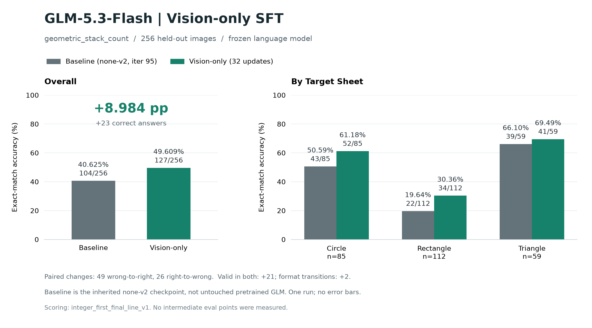

# Frozen-Language GLM-5.3 Vision SFT



The authoritative result, configuration and source hashes are in
[`recorded/result.json`](recorded/result.json). This is one measured
`geometric_stack_count` run: **104/256 (40.625%) -> 127/256 (49.609375%)**,
**+8.984375 percentage points**. The LLM was frozen; the complete visual tower,
including its projection, received 32 optimizer updates. Only the final
checkpoint was evaluated.

## Scope And Prerequisites

The baseline is **`chartqa_none_v2_seed42`, iteration 95**, whose language weights
were updated in an earlier experiment. It is **not untouched pretrained GLM**.
An exact replay requires that converted language checkpoint, its matching
multimodal HF export, and the unchanged starting visual weights. Those large
weights are not included here. A different starting checkpoint is a new
experiment and must have its own baseline.

Use a compatible Miles/Megatron/SGLang GLM-5.3 runtime on an already allocated
32-GPU Ray cluster. The measured full 45-layer run used 4 nodes with 8 H20 GPUs
each. Set the environment required by your runtime, including NCCL interfaces,
`CUDA_DEVICE_MAX_CONNECTIONS=1`, and the correct Megatron checkout. Do not use
an unallocated/shared GPU or start a replacement Ray cluster for this recipe.
The reproduction launcher does not run the native launcher's global `pkill`
preamble.

No teacher/self-distillation answers are used in this final experiment: training
targets are exact generator integers. The historical `distillation` dataset role
name denotes the training split, not a teacher-generation method.

## Rebuild The Exact Data

Install the SPHINX generator and its dependencies from the pinned revision:

```bash
git clone https://github.com/maveryn/sphinx.git "$SPHINX_CHECKOUT"
git -C "$SPHINX_CHECKOUT" checkout 28ef6c43629ab4491491a204167ef2f52dcd8182
pip install -e "$SPHINX_CHECKOUT"
python -m examples.glm53_vision_sft.prepare \
  --sphinx-checkout "$SPHINX_CHECKOUT" --output "$CORNER_DATA"
```

Run these Python commands from the Miles checkout. `prepare` reads the small
compressed scene specification shards, re-renders them through SPHINX, and
checks every decoded pixel hash. It preserves the original questions, labels
and order. Seeds alone are insufficient: upstream's target selection iterates
a Python set, whose order can change between environments. No PNGs or model
weights are committed.

The output has disjoint training/development/validation rows and
`sft_exact.jsonl`. The model sees only the image/question and the
`</think>\n<integer>` assistant target, never the geometry oracle. JSONL file
hashes change when image paths change; decoded pixels and labels must not.

## Baseline, Train, Final Eval

First evaluate the matching HF baseline with the same image-processing path.
`HF_BASE` must already contain its processor metadata and dedicated visual-only
shards. `BASE_EXPORT_SOURCE` is the `vision_export_source.json` emitted by
`tools/glm5_next_vision_export.py prepare` when exporting this same starting
language checkpoint. Keep that provenance file; do not hand-write a replacement.

```bash
export RAY_ADDRESS="$ALLOCATED_RAY_ADDRESS"
python -m examples.glm53_vision_sft.eval_mm \
  --model "$HF_BASE" --data "$CORNER_DATA/validation.jsonl" \
  --output "$BASELINE_PREDICTIONS" --max-new-tokens 4096 \
  --tp-size 8 --parallel-workers 4 --cache-root "$NODE_LOCAL_CACHE"
```

The default evaluation is greedy, with context length 8192 and CUDA graphs
disabled. Images go through the Miles GLM processor and SGLang's
`processor_output` interface, including expanded image-token IDs. Each worker
reserves one complete TP replica on the existing Ray cluster.

Use a new run directory; the output is an **evaluation-only visual snapshot**,
not a resumable native checkpoint:

```bash
MILES_SCRIPT_EXTERNAL_RAY=1 RAY_ADDRESS="$ALLOCATED_RAY_DASHBOARD" \
  python -m examples.glm53_vision_sft.run_glm5_3_flash_corner \
  --hf-checkpoint "$HF_STARTING_VISUAL" --ref-load "$NONE_V2_CHECKPOINTS" \
  --prompt-data "$CORNER_DATA/sft_exact.jsonl" --output-dir "$CORNER_RUN" \
  --megatron-path "$MEGATRON_CHECKOUT"

python -m examples.glm53_vision_sft.eval_mm \
  --model "$HF_BASE" --data "$CORNER_DATA/validation.jsonl" \
  --visual-snapshot "$CORNER_RUN/checkpoints/iter_0000031" \
  --base-export-source "$BASE_EXPORT_SOURCE" \
  --output "$TRAINED_PREDICTIONS" --max-new-tokens 4096 \
  --tp-size 8 --parallel-workers 4 --cache-root "$NODE_LOCAL_CACHE"

python -m examples.glm53_vision_sft.score \
  --data "$CORNER_DATA/validation.jsonl" --baseline "$BASELINE_PREDICTIONS" \
  --trained "$TRAINED_PREDICTIONS" --output "$NEW_RESULT"
python -m examples.glm53_vision_sft.plot \
  --result "$NEW_RESULT" --output "$NEW_EVAL_PLOT"
```

The visual overlay validates all frozen-language rank audits and visual hashes,
then reuses the exact baseline language shards. It does not re-quantize or
re-export the LLM. The training/sampling defaults belong to `result.json` and the
native recipe; inspect them there instead of maintaining a second configuration.

## Verify The Recorded Evidence Without GPUs

```bash
pip install matplotlib
python -m examples.glm53_vision_sft.plot \
  --answers examples/glm53_vision_sft/recorded/paired_answers.jsonl
```

This recomputes the summary from the recorded extracted per-sample answers
before regenerating the PNG. The strict scorer remains in `score.py`:
`integer_first_final_line_v1` reads the first nonempty final line after
`</think>`, permits simple Markdown wrappers and a trailing period, and rejects
unclosed reasoning or multiple closing tags. No oracle correction or
post-hoc validation filtering was applied. Raw predictions are not committed;
their original SHA256 hashes are recorded.

`frozen_audits.json` contains all 32 rank audits from the measured run.
All LLM hashes are unchanged, all ranks recorded 32 successful updates, and
the 8 visual replicas agree on their final hash.

## Limitations

- This demonstrates this vision-only train/save/load/image-eval path, not broad
  benchmark generalization, multiple-seed reproducibility, or training resume.
- The task counts objects inside complete sheet boundaries, including portions
  covered by higher sheets. All small black objects are drawn on top. The data
  audit independently checked all 1,312 geometric scenes and found no cross-role
  pixel/structure/seed/ID overlap.
- Two training targets have completely invisible sheet colors. Validation has
  none, but hidden boundaries may not always be uniquely recoverable. These
  samples were not retroactively removed.
- Always answering `1` scores 37.890625% on this answer-skewed validation set.
  Among 238 samples valid under both outputs, correct answers increased
  102 -> 123. Validity transitions contribute the remaining net +2 of +23.
- The original measured train and final evaluation wall times were about
  44m20s and 13m14s respectively, not a hardware-independent runtime guarantee.
- This contribution intentionally does not include test files or launcher
  snapshots. CPU verification was performed separately; full upstream CI and
  a new full-model training replay are not claimed.

## Attribution

SPHINX scene metadata and rendering are from `maveryn/sphinx` at the revision
above. See [`recorded/SPHINX_LICENSE.txt`](recorded/SPHINX_LICENSE.txt).
